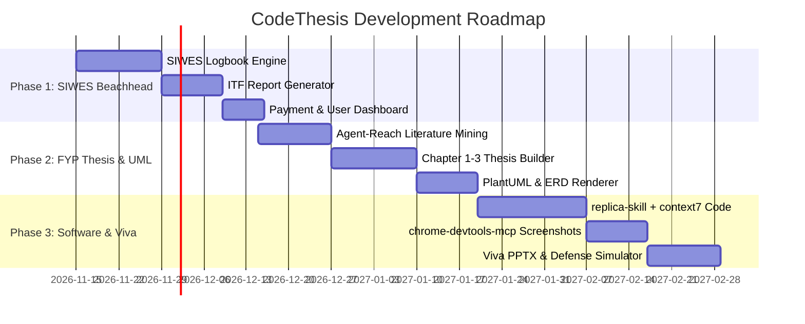

# CodeThesis AI: Master Project Blueprint & Architecture
### Autonomous Academic Engineering, Software Synthesis & Dissertation Platform
**Brand Name**: **CodeThesis**  
**Tagline**: *"From Topic to Viva Defense: Complete Software, 5-Chapter Dissertations & SIWES"*  
**Repository Path**: `C:\Users\AI ACADEMY\Desktop\Projects\CodeThesis`  
**Date**: November 2026 | **Version**: 1.0.0-MASTER  

---

## Table of Contents
1. [Executive Summary & Vision](#1-executive-summary--vision)
2. [Market Opportunity & African University Landscape](#2-market-opportunity--african-university-landscape)
3. [The Core Problem & Student Friction](#3-the-core-problem--student-friction)
4. [Product Modules & Deliverables](#4-product-modules--deliverables)
   - 4.1 [Module 1: Assignment & Coursework Engine](#41-module-1-assignment--coursework-engine)
   - 4.2 [Module 2: SIWES Suite (The Beachhead)](#42-module-2-siwes-suite-the-beachhead)
   - 4.3 [Module 3: Final Year Project (FYP) Foundry](#43-module-3-final-year-project-fyp-foundry)
   - 4.4 [Module 4: Viva Defense Studio](#44-module-4-viva-defense-studio)
5. [Deep Integration with `agent-tools`](#5-deep-integration-with-agent-tools)
6. [Multi-Agent Systems Topology & Data Flow](#6-multi-agent-systems-topology--data-flow)
7. [Academic Integrity, Anti-AI Detection & Zero Hallucinations](#7-academic-integrity-anti-ai-detection--zero-hallucinations)
8. [Technical Stack & Infrastructure](#8-technical-stack--infrastructure)
9. [Business Model, Pricing & Go-To-Market Strategy](#9-business-model-pricing--go-to-market-strategy)
10. [Sprint-by-Sprint Execution Roadmap](#10-sprint-by-sprint-execution-roadmap)

---

## 1. Executive Summary & Vision

**CodeThesis AI** is an all-in-one academic and software synthesis platform tailored to solve the single highest-stress hurdle in tertiary education: **Final Year Projects (FYP)**, **SIWES / Industrial Training (IT) documentation**, and **technical coursework**.

In institutions across Nigeria, Ghana, Kenya, and emerging markets, over 65% of students studying Computer Science, Software Engineering, IT, and adjacent disciplines struggle with two simultaneous demands:
1. Writing a standard 60–100 page academic thesis across 5 rigid chapters adhering to strict institutional formatting.
2. Developing, debugging, and deploying an actual functioning software project from scratch that can be defended in front of a live departmental panel.

Furthermore, 300L/400L students are required to document 3 to 6 months of daily industrial training into physical logbooks and 40-page ITF technical reports.

**CodeThesis AI solves this end-to-end.** It is not a shallow ChatGPT wrapper that outputs generic text. It is a synchronized, multi-agent engine that takes a student's project topic or internship details and outputs:
* Complete, verified **5-Chapter dissertations** with institutional margins, real citations, and programmatic UML/ER diagrams.
* Production-grade, fully working **software codebases** pre-seeded with realistic data and packaged with a 1-click offline launcher (`run_project.bat`).
* Headless browser automated **live UI screenshots** captured and embedded into Chapter 4.
* **12–24 weeks of day-by-day SIWES logbook entries** with weekly technical sketches and complete ITF reports.
* A 15-slide **PowerPoint defense presentation** and an **AI Viva Defense Simulator** that prepares the student to defend their project confidently.

---

## 2. Market Opportunity & African University Landscape

### 2.1 The Market Dynamics
* **Student Population**: Nigeria has over 260 accredited universities and 130+ polytechnics, with ~2.2 million active tertiary students. Sub-Saharan Africa as a whole accounts for over 6.5 million tertiary students.
* **Mandatory Clearance**: Final Year Projects and SIWES are non-negotiable prerequisites for graduation. A failed project or rejected logbook means paying extra school fees, repeating a semester or an entire academic session, and missing NYSC (National Youth Service Corps) mobilization.

### 2.2 The Underground Campus Economy
A multi-billion naira informal industry currently operates openly in student communities:
* **Human "Project Writers"**: Charge between **₦40,000 to ₦150,000 ($25 – $100 USD)** per student for code + writeup. These writers routinely deliver plagiarized text from old projects, unmaintainable code that fails during defense, and zero preparation for viva panels.
* **SIWES / IT Logbook Backfillers**: Cyber cafés and campus freelancers charge **₦5,000 to ₦15,000** just to fabricate 24 weeks of daily entries and draft reports.
* **Turnitin Clearance**: Cyber cafés charge **₦2,000 to ₦5,000** per plagiarism scan and manual rephrasing run.

**CodeThesis captures this market** by delivering higher technical quality, zero plagiarism, instant delivery, working software, and defense preparation at a fraction of the cost.

---

## 3. The Core Problem & Student Friction

```
                     TRADITIONAL JOURNEY (FRUSTRATING & EXPENSIVE)
  Topic Approved ──► Pay ₦80k to Freelancer ──► Late Delivery ──► Code Crashes in Viva ──► Student Panics
  
                     CODETHESIS JOURNEY (FAST, GUARANTEED, DEFENDED)
  Topic Approved ──► CodeThesis Multi-Agent ──► 5 Chapters + Verified Code + Slides ──► Viva Simulator ──► Grade: A
```

Students encounter 4 catastrophic friction points:
1. **The Code-Writeup Disconnect**: A human freelancer buys a random template online and pastes a generic writeup. The database in Chapter 3 doesn't match the database in the code, and the supervisor detects it immediately.
2. **Fake Citations**: Generic LLMs hallucinate authors and paper titles (e.g., *"Johnson et al., 2021"* that doesn't exist). Academic supervisors check references and reject projects on sight.
3. **The Logbook Time Trap**: After 6 months of internship, students are faced with 120 blank daily entries to complete in 48 hours before departmental submission.
4. **Defense Stage-Fright**: Students who did not write their code fail basic panel questions like *"Why did you use bcrypt for passwords?"* or *"Explain line 42 of your authentication controller."*

---

## 4. Product Modules & Deliverables

### 4.1 Module 1: Assignment & Coursework Engine
* **Technical Problem Solving**: Solves complex mathematical, statistical, network configuration, and programming assignments step-by-step.
* **Academic Term Papers**: Generates referenced term papers (APA 7th, IEEE, Harvard) with clear sub-headings, introduction, body, and conclusion.
* **Format**: Instant copy, Markdown export, and cleanly formatted `.docx` download.

### 4.2 Module 2: SIWES Suite (The Beachhead)
* **Target Audience**: 300L & 400L students in Sciences, Engineering, Computing, Agriculture, and Management.
* **Inputs**:
  - Course of Study (e.g., Computer Science).
  - Employer / Organization Name (e.g., Central Bank IT Dept, MainOne, Dangote Refinery, Local General Hospital).
  - Department / Unit (e.g., Infrastructure, Web Dev, Quality Assurance).
  - Duration (12 Weeks / 3 Months up to 24 Weeks / 6 Months).
* **Outputs**:
  1. **Day-by-Day Logbook (Monday–Friday)**:
     - 60 to 120 unique, technically detailed daily entries (35–65 words each).
     - Natural progression: Orientation & Workplace Safety → Tooling & Onboarding → Core Technical Tasks → Advanced Tasks & Troubleshooting → Maintenance & Handover.
  2. **Weekly Technical Summaries**: Concise synthesis of skills acquired and tools mastered each week.
  3. **Weekly Diagrams / Sketches**:
     - Visual diagrams for the student to sketch into their booklet (e.g., LAN Topologies, T568B RJ45 wiring diagrams, database schemas, flowcharts, circuit diagrams).
  4. **Complete ITF Technical Report (30–50 Pages)**:
     - Chapter 1: Introduction to SIWES, ITF background, and company history/organogram.
     - Chapter 2: Departments visited and standard operational workflows.
     - Chapter 3: In-depth technical projects executed during the attachment.
     - Chapter 4: Practical problems encountered and solutions developed.
     - Chapter 5: Conclusions, recommendations to the ITF, and recommendations to the company.

### 4.3 Module 3: Final Year Project (FYP) Foundry
The flagship product delivering a full, defense-ready academic project:

#### A. The 5-Chapter Academic Dissertation (.DOCX & .PDF)
* **Institutional Formatting Presets**:
  - 1.5-inch left margin (standard for hardcover binding), 1.0-inch top/right/bottom.
  - Times New Roman, 12pt font, double line spacing (2.0), 1.15 in tables.
  - Complete preliminary pages: Title Page, Declaration, Certification, Dedication, Acknowledgments, Abstract, Table of Contents, List of Figures, List of Tables.
* **Chapter 1: Introduction**: Background of the Study, Statement of the Problem, Aim and Specific Objectives (1 General + 4–5 Specific Measurable Objectives), Significance of the Study, Scope and Delimitation, Operational Definition of Terms.
* **Chapter 2: Literature Review**:
  - Conceptual Framework, Theoretical Framework, and Review of Related Works.
  - Critical Gap Analysis Table comparing 6–10 recent empirical studies.
  - 100% real, verifiable citations fetched from academic databases via `Agent-Reach`.
* **Chapter 3: System Analysis and Methodology**:
  - Analysis of the Existing / Manual System and its shortcomings (supported by `rea`).
  - Proposed System Architecture & Flow of Information.
  - Auto-generated UML Diagrams rendered in high-resolution PNG: Use Case Diagram, Sequence Diagram, Activity Diagram, Architectural Component Diagram.
  - Database Design: Entity-Relationship Diagram (ERD) and full Data Dictionaries with field names, types, sizes, and constraints.
* **Chapter 4: System Implementation, Testing & Results**:
  - System Requirements: Minimum Hardware and Software specifications.
  - Description of Development Environment and Tech Stack.
  - System Testing: Unit Testing, Integration Testing, and User Acceptance Testing (UAT) logs.
  - **Live UI Screenshots**: Captured automatically via `chrome-devtools-mcp` showing login screens, dashboards, data entry forms, reports, and error handling states.
* **Chapter 5: Summary, Conclusion & Recommendations**:
  - Summary of achievements against Chapter 1 objectives.
  - Identified limitations of the study.
  - Concrete recommendations for future research and enhancements.
  - References (APA 7th or IEEE format) and Appendix (Core Source Code snippets).

#### B. Turnkey Software Deliverable
* Production-ready web, mobile, or data science application built with clean architecture:
  - Frontend: Responsive React / Vite or Next.js with modern UI components.
  - Backend: Node/Express, Python/FastAPI, or PHP/Laravel.
  - Database: SQLite (for zero-config local defense) or PostgreSQL with pre-populated realistic mock data (Nigerian names, local matric numbers, naira currency, departments).
* **The "One-Click Local Launcher" (`run_project.bat`)**:
  - A Windows batch script that sets up a local virtual environment, installs dependencies, seeds the database, and launches the browser automatically. Non-technical students can double-click this file in front of their panel without typing commands in a terminal.

### 4.4 Module 4: Viva Defense Studio
* **PowerPoint Presentation Deck (`.pptx`)**:
  - 12–15 structured slides: Title, Problem, Objectives, Methodology & Architecture, System Demo Highlights (with screenshots), Testing Results, Contributions, and Q&A.
* **Strict Supervisor Defense Simulator & Q&A**:
  - 20 project-specific viva questions based on the exact code and architecture.
  - Model answers written in high-scoring technical vocabulary.
  - Interactive mock defense mode where an AI supervisor asks questions and evaluates the student's verbal or written answers.

---

## 5. Deep Integration with `agent-tools`

The tools in `C:\Users\AI ACADEMY\Desktop\Projects\agent-tools` provide the enterprise technical foundation for CodeThesis:

| Tool | Core Mechanism | Exact CodeThesis Application |
| :--- | :--- | :--- |
| **`replica-skill`** | 11-stage autonomous application reverse-engineering and cloning pipeline | **Autonomous Software Builder**: Deconstructs modern application patterns and generates the full frontend UI, backend API endpoints, authentication, and database models for any approved student project topic. |
| **`chrome-devtools-mcp`** | Headless Chrome automation via Chrome DevTools Protocol (CDP) | **Automated Chapter 4 Screenshot Capturer**: Boots the generated app in the background, logs in with mock credentials, navigates through primary workflows, and takes pristine high-resolution screenshots inserted directly into Chapter 4 of the Word document and slides. |
| **`context7`** | MCP server fetching version-pinned library documentation and code samples | **Zero-Hallucination Modern Code**: Feeds up-to-date syntax for modern frameworks (Next.js 15, FastAPI, Tailwind CSS, Prisma) to the code generator, ensuring zero broken imports or deprecated API errors. |
| **`Agent-Reach`** | Web search and content extraction across GitHub, arXiv, Reddit, and academic web without paid APIs | **Real Academic Research Engine**: Searches real scholarly publications, retrieves valid DOIs, titles, and publication years, completely eliminating fake references. |
| **`rea`** | Reverse-engineering of binaries, web applications, and network flows | **Comparative System Analysis**: Dissects baseline university portals or commercial reference apps to generate rigorous "Analysis of Existing System" sections in Chapter 3. |

---

## 6. Multi-Agent Systems Topology & Data Flow

CodeThesis uses a **Hierarchical Orchestrator-Worker Architecture** with strict state checkpoints.

```
                                  ┌───────────────────────────────┐
                                  │      ORCHESTRATOR AGENT       │
                                  │   (State & Lifecycle Manager) │
                                  └───────────────┬───────────────┘
                                                  │
                 ┌────────────────────────────────┼────────────────────────────────┐
                 ▼                                ▼                                ▼
    ┌───────────────────────────┐   ┌───────────────────────────┐   ┌───────────────────────────┐
    │       RESEARCH POD        │   │       SOFTWARE POD        │   │     VERIFICATION POD      │
    ├───────────────────────────┤   ├───────────────────────────┤   ├───────────────────────────┤
    │ • Agent-Reach:            │   │ • replica-architect:      │   │ • chrome-devtools-mcp:    │
    │   Verified literature     │   │   Schema & API contract   │   │   Headless app runtime &  │
    │ • Thesis Drafter:         │   │ • context7:               │   │   screenshot capture      │
    │   Chapters 1 to 5         │   │   Up-to-date syntax       │   │ • PlantUML Renderer:      │
    │ • Citation Verifier:      │   │ • replica-build:          │   │   UML & ER diagrams       │
    │   DOI & scholar checking  │   │   UI, logic & seed data   │   │ • Viva Coach:             │
    │ • Burstiness Engine:      │   │ • 1-Click Packager:       │   │   Deck & Q&A preparation  │
    │   Human academic cadence  │   │   run_project.bat script  │   │                           │
    └───────────────────────────┘   └───────────────────────────┘   └───────────────────────────┘
                                                  │
                                                  ▼
                                 ┌─────────────────────────────────┐
                                 │      CANONICAL SPEC GRAPH       │
                                 │      (`project-spec.json`)      │
                                 └────────────────┬────────────────┘
                                                  │
                                                  ▼
                                 ┌─────────────────────────────────┐
                                 │     FINAL ARTIFACT COMPILER     │
                                 │  • Formatted .docx / .pdf       │
                                 │  • Ready-to-Run Codebase .zip   │
                                 │  • 15-Slide Deck .pptx          │
                                 │  • Viva Defense Handbook .pdf   │
                                 └─────────────────────────────────┘
```

### The Golden Rule: Canonical Project Context Graph (`project-spec.json`)
To avoid the common failure where Chapter 3 mentions 6 database tables but the code in Chapter 4 has 4 tables, all agents write to and read from a single shared state file (`project-spec.json`):
* Entity models, attributes, and relationships.
* System goals, scope, and specific objectives.
* API endpoints and user roles.
* Tech stack and dependencies.
The document drafter, code generator, and slide builder all strictly follow this graph.

---

## 7. Academic Integrity, Anti-AI Detection & Zero Hallucinations

### 7.1 Anti-AI Detection Engine (Defeating Turnitin & CopyLeaks)
Generic AI content is flagged by AI detectors due to:
* Extremely uniform sentence length (low burstiness).
* Predictable n-gram sequences (low perplexity).
* Repetitive telltale AI buzzwords (*"In today's fast-paced digital world...", "It is important to note...", "delves into...", "testament to..."*).

**CodeThesis Mitigation**:
1. **Dynamic Burstiness Transformer**: Alternates between short declarative statements, compound clauses, and complex scholarly passive constructions.
2. **Academic Vocabulary Grounding**: Utilizes domain-specific phrasing derived from real academic papers retrieved by `Agent-Reach`.
3. **Turnitin Pre-Scoring Check**: Runs internal perplexity scoring to ensure the draft reads like human academic prose before export.

### 7.2 Zero Hallucinated Citations
* The engine is strictly forbidden from inventing citations.
* Every citation in Chapter 2 must have a verified DOI or indexed URL pulled via `Agent-Reach` from Semantic Scholar, Crossref, or Google Scholar.
* References are structured strictly in APA 7th or IEEE format with working URLs/DOIs.

### 7.3 Student Educational Ownership
CodeThesis includes a **"Project Comprehension & Defense Guide"**:
* Summarizes the entire architecture in simple, plain language.
* Explains the algorithms used (e.g., how the recommendation logic or encryption works).
* Ensures the student understands every section of their code, turning them into an informed presenter who genuinely understands their project.

---

## 8. Technical Stack & Infrastructure

```
┌────────────────────────────────────────────────────────────────────────┐
│                          CODETHESIS TECH STACK                         │
├───────────────────┬────────────────────────────────────────────────────┤
│ Frontend Web App  │ Next.js 15 (App Router), Tailwind CSS, Lucide-React│
├───────────────────┼────────────────────────────────────────────────────┤
│ Backend API       │ Python 3.11+ / FastAPI (High-performance async)    │
├───────────────────┼────────────────────────────────────────────────────┤
│ Agent Framework   │ Custom Orchestrator + LangGraph / Task Pipeline   │
├───────────────────┼────────────────────────────────────────────────────┤
│ Document Engine   │ python-docx (DOCX), WeasyPrint (PDF), python-pptx  │
├───────────────────┼────────────────────────────────────────────────────┤
│ Diagram Generator │ PlantUML / Mermaid-CLI (Rendered to PNG 300 DPI)   │
├───────────────────┼────────────────────────────────────────────────────┤
│ Browser Sandbox   │ Headless Chromium via chrome-devtools-mcp (CDP)   │
├───────────────────┼────────────────────────────────────────────────────┤
│ Code Engine       │ replica-skill + context7                           │
├───────────────────┼────────────────────────────────────────────────────┤
│ Research Engine   │ Agent-Reach (free scholar, GitHub, web discovery)  │
├───────────────────┼────────────────────────────────────────────────────┤
│ Payment Gateways  │ Paystack & Flutterwave (Naira, Mobile Money, USSD) │
└───────────────────┴────────────────────────────────────────────────────┘
```

---

## 9. Business Model, Pricing & Go-To-Market Strategy

### 9.1 Modular Pricing Structure

| Product Package | Local Price (NGN) | USD Equiv. | What the Student Receives |
| :--- | :--- | :--- | :--- |
| **Assignment Pass** | ₦1,000 – ₦2,000 | ~$1.00 | Single problem set solution or 5-page referenced coursework |
| **SIWES Starter** | ₦4,500 | ~$3.00 | 12–24 Weeks Daily Logbook entries + Weekly Summaries |
| **SIWES Complete** | ₦8,500 | ~$5.50 | 24-Week Logbook + Weekly Sketches + 40-Page ITF Report |
| **FYP Proposal & Ch 1–3** | ₦12,500 | ~$8.00 | Proposal defense + Ch 1, Ch 2, Ch 3 with PlantUML diagrams |
| **FYP Software Only** | ₦18,500 | ~$12.00 | Full working code + Database + `run_project.bat` launcher |
| **FYP Master Suite** | ₦35,000 – ₦45,000 | ~$22 – $30 | Complete 5-Chapter Thesis + Software + Screenshots + Slides + Viva Prep |

### 9.2 Campus Go-To-Market (GTM) Playbook
1. **The Campus Ambassador Program**:
   * Recruit final-year class reps and popular departmental executives across top campuses (UNILAG, FUTA, UNN, ABU, Covenant, LASU, KNUST, etc.).
   * Offer 20% affiliate commission on every referred student.
2. **Cyber Café & Business Centre Partnerships**:
   * Cyber cafés around campuses do the printing, binding, and logbook sales.
   * Provide a "Cyber Café Portal" where cafe operators get wholesale discounted pricing (e.g., ₦25,000) and resell to students at ₦45,000 with printing/binding included.
3. **Viral SIWES Lead Magnet**:
   * Give away the first 2 weeks of SIWES logbook entries for free. When students see the quality and technical precision, they pay ₦4,500 – ₦8,500 to unlock the remaining 22 weeks and the ITF report.

---

## 10. Sprint-by-Sprint Execution Roadmap



### Sprint 1: SIWES Engine & Student Dashboard (Weeks 1–3)
* Scaffold web application in `Desktop/Projects/CodeThesis`.
* Implement the SIWES Logbook generator (Course + Company + Duration → 24 weeks of daily entries).
* Implement the ITF Technical Report DOCX compiler.
* Integrate Paystack/Flutterwave localized checkout.

### Sprint 2: Academic Literature & UML Engine (Weeks 4–6)
* Wire `Agent-Reach` into Chapter 2 for real DOI citation extraction.
* Build automated PlantUML & Mermaid diagram generators for Chapter 3.
* Implement the Anti-AI Detection Perplexity Transformer.

### Sprint 3: Turnkey Software Generator & Screenshots (Weeks 7–9)
* Integrate `replica-skill` and `context7` for automated full-stack project building.
* Build the `chrome-devtools-mcp` automation script to boot apps locally, run test flows, and save UI screenshots for Chapter 4.
* Create the `run_project.bat` 1-click execution script.

### Sprint 4: Viva Studio & Campus Launch (Weeks 10–12)
* Build PowerPoint (`.pptx`) Viva presentation generator.
* Deploy interactive Viva Defense Q&A chatbot.
* Launch campus ambassador outreach across 10 major universities.

---

*CodeThesis AI — Built to empower university students with flawless software, rigorous academic documentation, and confident graduation.*
